<div align="center">


# Free My TV

**A fast, ad-free home screen for Google TV.**

Trending picks from your own apps, the weather at a glance, and a look that follows the sunset.<br>
Open source. Built with Claude Code. One button to undo.

[**freemytv.io**](https://freemytv.io) · [Install](#install) · [Any TV](#any-tv) · [Make it yours](#make-it-yours)

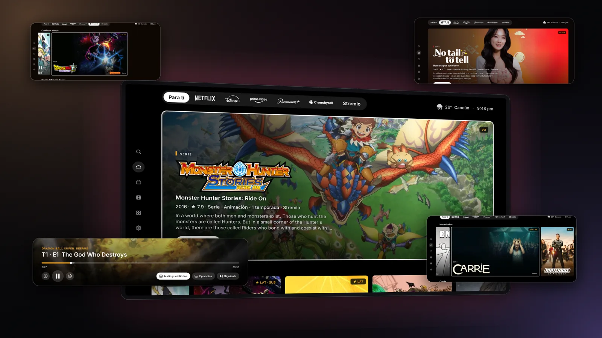

</div>

> **Esta versión:** instrucciones de instalación y configuración en español en [SETUP.md](SETUP.md).

## Esta versión

Un home al estilo de las apps de streaming: un destacado con tráiler, filas de recomendaciones (de TMDB y de lo que ves en Stremio), una pestaña por servicio, una pantalla por serie y un reproductor propio para Stremio.

| | |
|---|---|
| 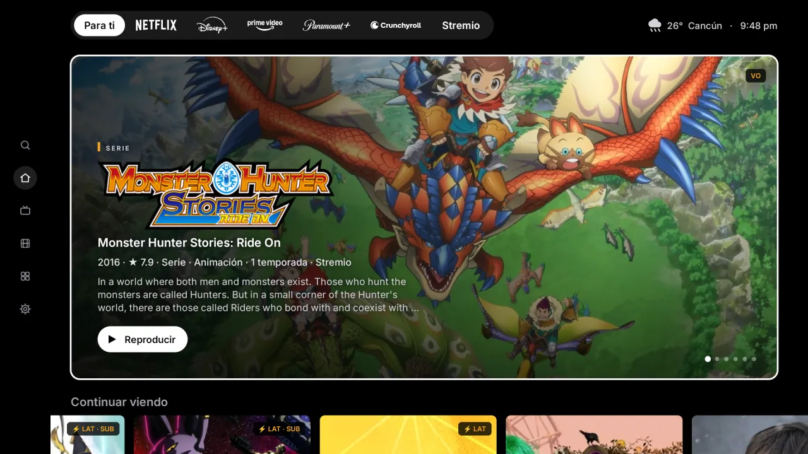<br>**Para ti:** el destacado, con su tráiler | 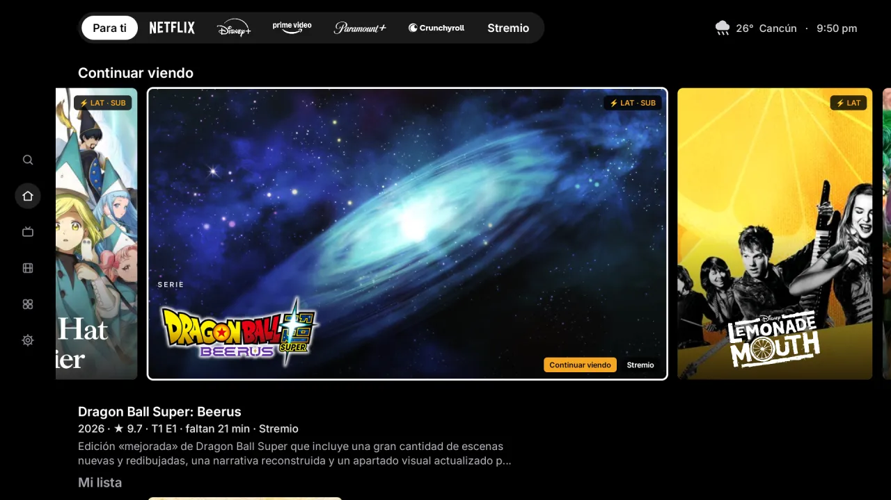<br>**Continuar viendo,** desde tu cuenta de Stremio |
| 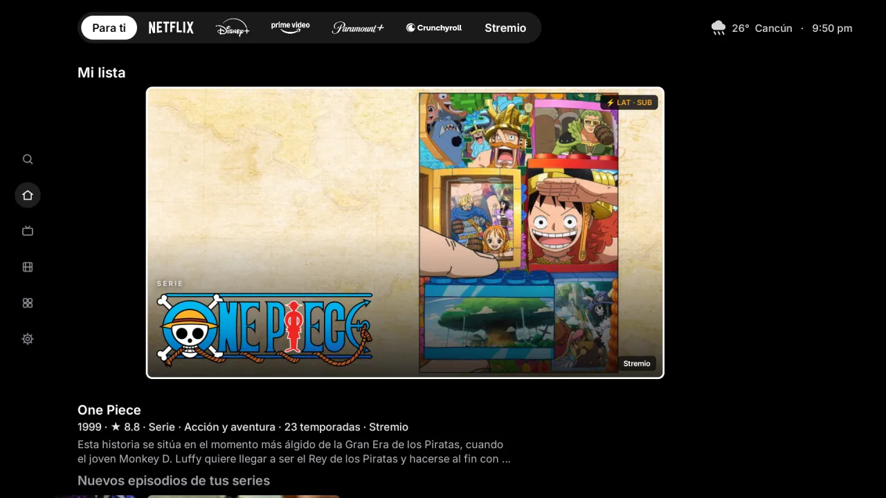<br>**Mi lista,** también de Stremio | 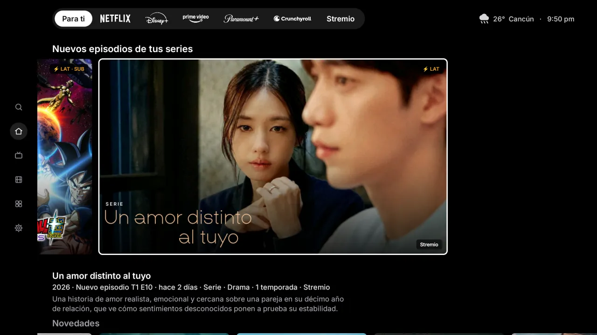<br>**Nuevos episodios** de tus series |
| 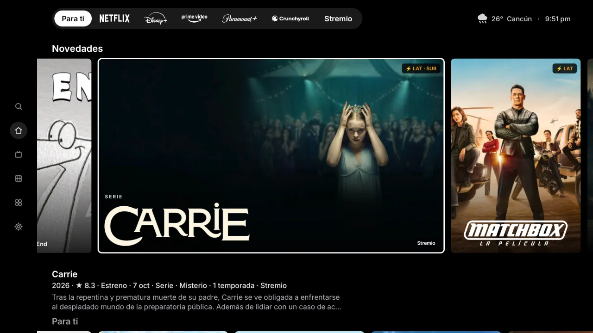<br>**Novedades:** los estrenos | 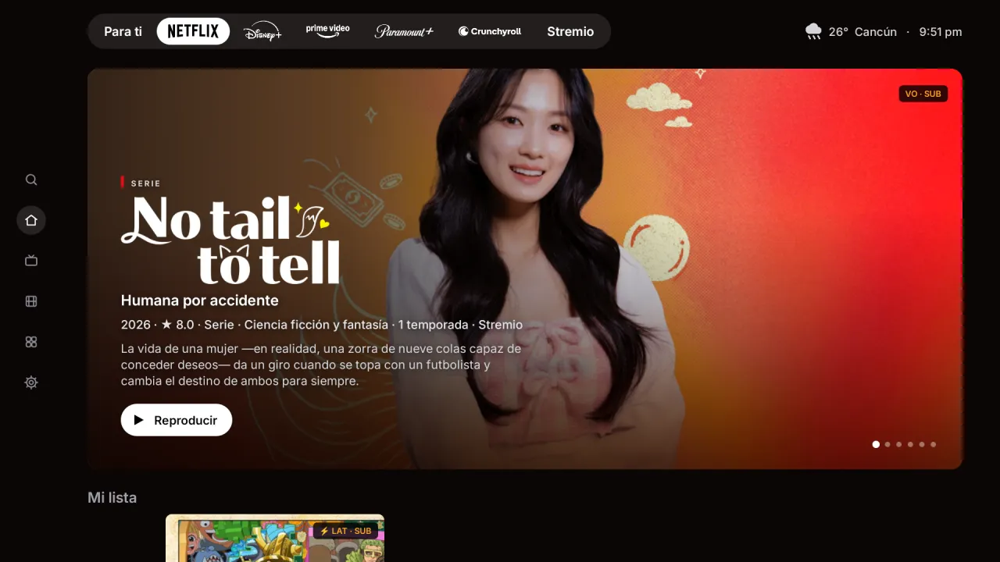<br>**Una pestaña por servicio:** Netflix |
| 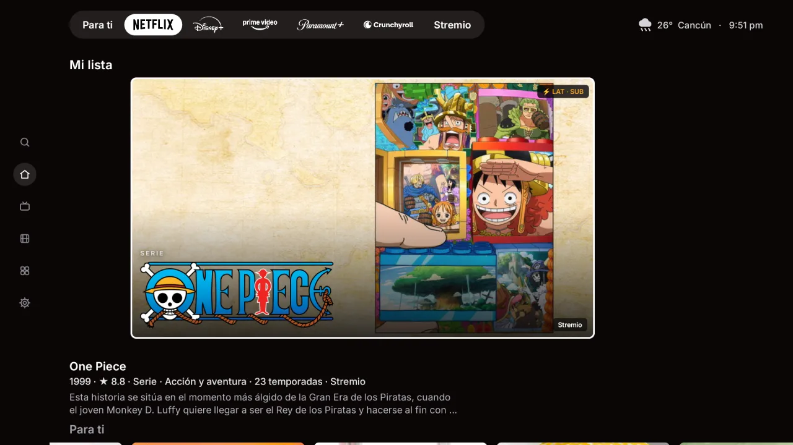<br>**Filas propias** en cada servicio | 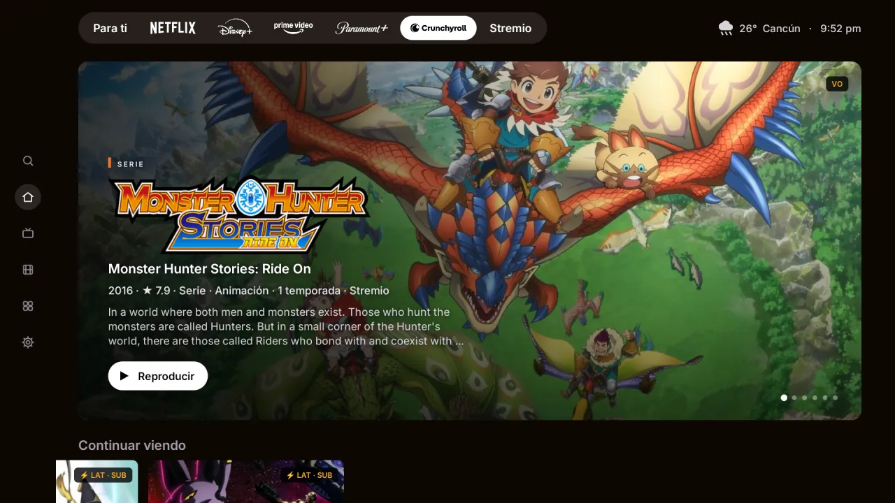<br>**Anime** (Crunchyroll) |
| 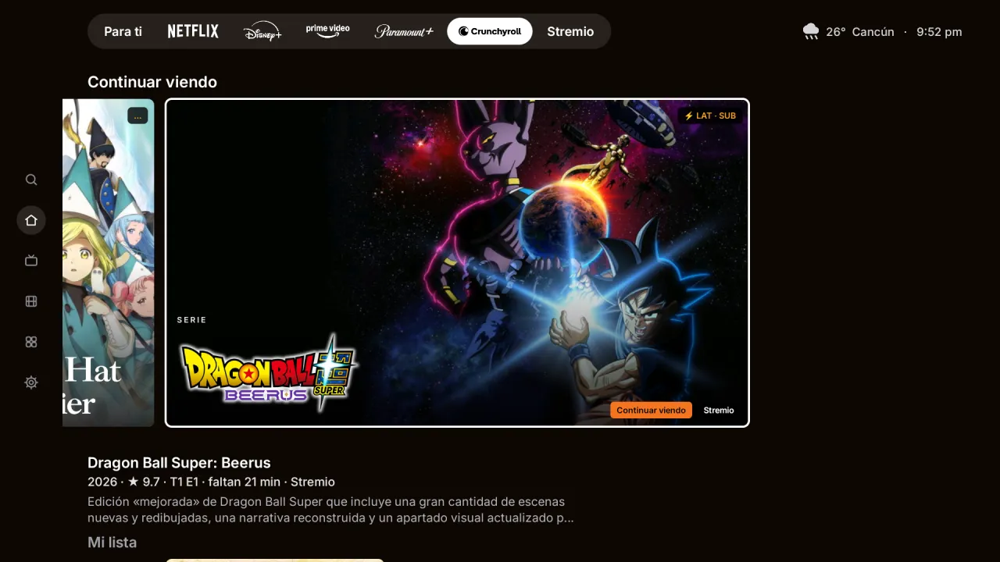<br>**Continuar viendo** en cada servicio | 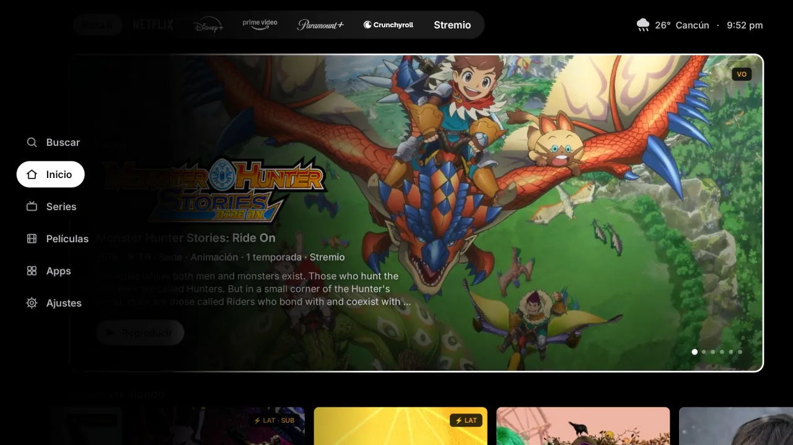<br>**El menú:** buscar, series, películas, apps y ajustes |
| 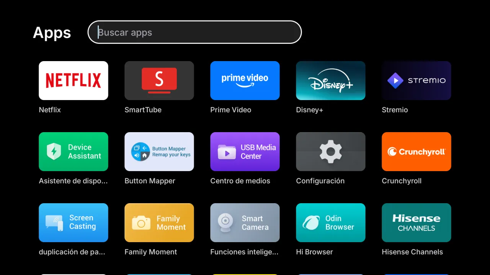<br>**Todas tus apps,** con buscador | 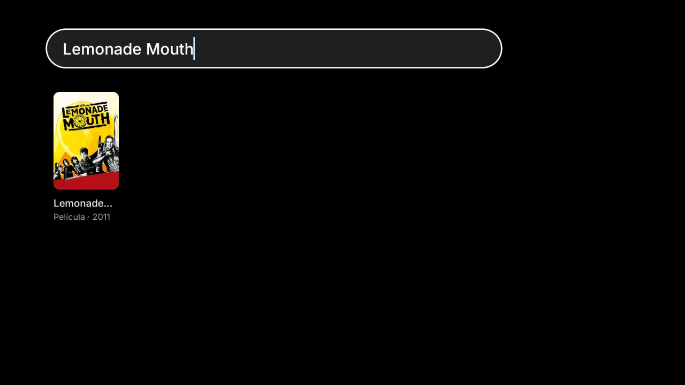<br>**Buscar** |
| 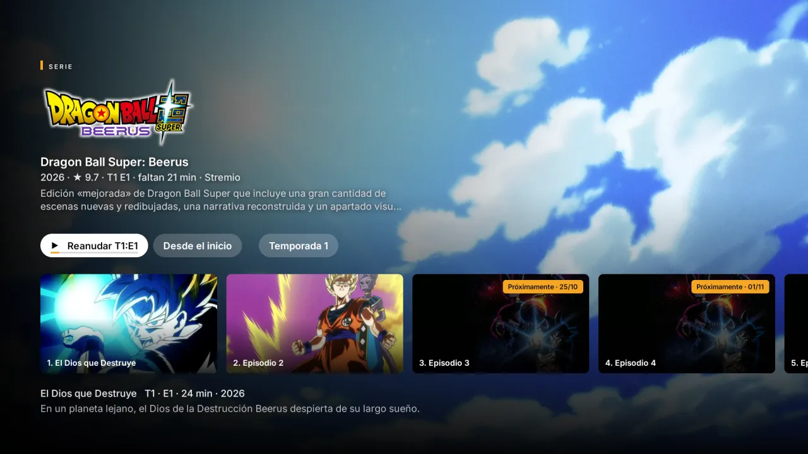<br>**Una pantalla por serie:** reanudar, temporadas y próximos capítulos | 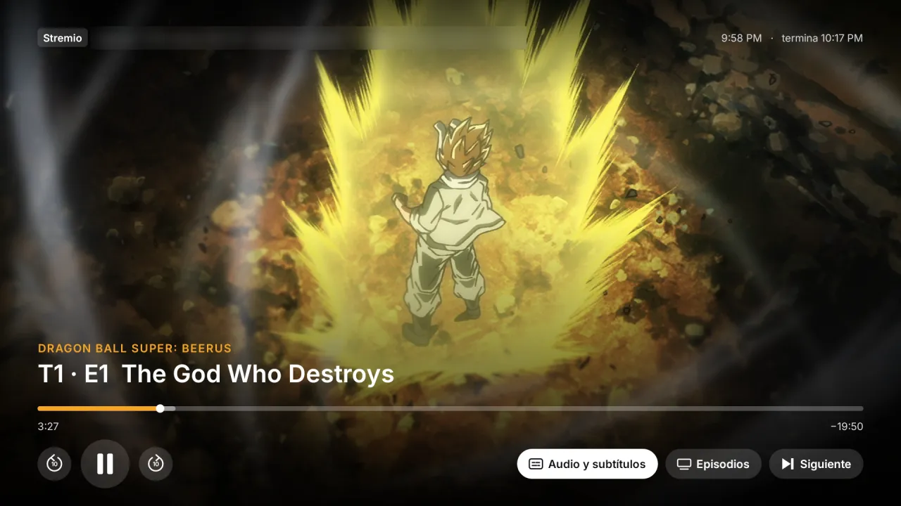<br>**El reproductor propio,** con tu avance sincronizado a Stremio |
| 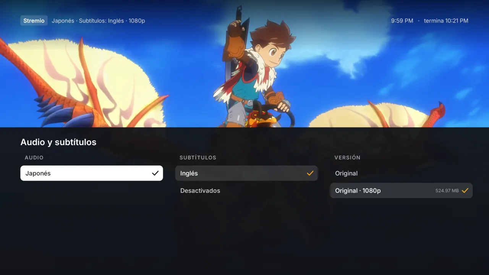<br>**Audio, subtítulos y versión** | |

## What you get

- **No ads.** No sponsored rows, banners or autoplaying promos. Not one.
- **Your apps, front and center.** The streaming apps you actually use, on a glass shelf.
- **Trending, not sponsored.** Three fresh picks every hour from what's trending this week and the latest releases, only from apps you already have. Movies and Shows get their own tabs.
- **Weather and markets, one press away.** The hour-by-hour forecast, sunrise and sunset, and live crypto prices.
- **Light by day, dark by night.** It follows your city's real sunset, the way your phone does.
- **A screensaver to match.** Full-screen photos of the picks with a big glass clock.
- **Fast.** 60 fps, every frame in 16.6 ms, on the TV's own chip. The home screen uses 96 MB of memory instead of 242 MB (−60%).<br><sub>Measured on a 98″ TCL Google TV running Android 14.</sub>
- **Safe.** No root. Nothing is uninstalled. One button brings back the factory home screen.

## Install

About ten minutes. You need a Google TV or Android TV (Android 12 or newer) and a computer on the same Wi-Fi.

### The easy way: Claude Code

1. **On the TV**, turn on developer mode: Settings → System → About → press *Android TV OS build* 7 times. Then Settings → System → Developer options → turn on **USB debugging**. Write down the TV's IP address (Settings → Network & Internet).
2. **On your computer**, get the code:
   ```bash
   git clone https://github.com/javiermiz/free-my-tv && cd free-my-tv
   ```
3. **Open [Claude Code](https://claude.com/claude-code) in that folder** and say:
   > Install Free My TV on my TV at 192.168.1.50. I live in Lisbon.

   It installs the tools it needs, builds the app and puts it on your TV. Swap in your TV's IP and your city.
4. **On the TV**, open *Free My TV* → *Home Screen* → *Free My TV*, and accept the debugging prompt (tick *Always allow*).

### The manual way

1. **On the TV**, do step 1 above.
2. **Tools:** a JDK (17+), the Android SDK command-line tools (build-tools 34, platform android-34) and adb. On a Mac:
   ```bash
   brew install --cask temurin android-commandlinetools android-platform-tools
   sdkmanager "build-tools;34.0.0" "platforms;android-34"
   ```
   On Linux, get OpenJDK 17, Android's command-line tools and adb from your package manager, then run the same `sdkmanager` line. On Windows, use WSL.
3. **Build:**
   ```bash
   ./build.sh
   ```
   The first run creates `config.properties`. Set your city and your [TMDB key](#the-tmdb-key) there, then run it again.
4. **Install:**
   ```bash
   adb connect 192.168.1.50:5555
   adb install -r FreeMyTV.apk
   ```
5. **On the TV**, open *Free My TV* → *Home Screen* → *Free My TV*.

## Settings

Everything lives in `config.properties`, created by the first build:

| Key | What it does | Default |
|---|---|---|
| `tmdb_key` | Your free TMDB key, for the picks | empty |
| `tmdb_region` | Your country (two letters): which titles are on which app | `US` |
| `latitude`, `longitude` | Your city, for the weather and the sunset | New York |
| `city` | The name on the weather card | `Weather` |
| `language` | `auto` (follows the TV), `en` or `pt` | `auto` |
| `currency` | Crypto prices in `USD`, `EUR`, `BRL`… | `USD` |
| `temperature` | `C`, `F` or `auto` | `auto` |
| `disable_assistant` | Also turn off Google Assistant | `false` |

Changed something? Run `./build.sh` and install again. Keep `freemytv.keystore`: updates are signed with it.

### The TMDB key

Free, and it takes two minutes: create an account at [themoviedb.org](https://www.themoviedb.org/signup), then open [Settings → API](https://www.themoviedb.org/settings/api) and request a developer key. Paste the *API Read Access Token* (or the *API Key*) after `tmdb_key=`. It's your key: `config.properties` stays out of git.

## Going back

On the TV: *Free My TV* → *Home Screen* → *Original*. The factory home screen, screensaver and every app come back exactly as they were. If the new home screen ever crashes three times in five minutes, it switches back by itself.

To remove it for good, switch to *Original* first, then uninstall *Free My TV* (Settings → Apps).

## What it changes

- It becomes the home screen and the screensaver.
- It turns off, without uninstalling:
  - the stock home screen and screensaver, with the remote shortcuts they run on some TVs (like the Netflix button on TCL);
  - Google TV's recovery home, Play Games and YouTube Music;
  - on TCL TVs, the TCL Channel, messages, store demo, hotel menu, manuals, mirroring and logging apps;
  - Google Assistant, only with `disable_assistant=true`.
- Picture, sound, inputs, remote pairing, Google services and the Play Store are on a protected list, checked before every change.

## Any TV

Free My TV runs on Google TV and Android TV: TCL, Sony, Hisense, Philips, Xiaomi and more, plus streamers like Chromecast with Google TV, the Google TV Streamer, onn 4K and NVIDIA Shield.

**Samsung, LG or any other TV:** plug a Google TV streamer into HDMI and free that one. Same steps, same home screen.

**A different brand or model:** ask Claude. Free My TV is made to be adapted by AI. Open the folder in Claude Code and say *"set it up for my Sony"*: it reads your TV, finds its home screen and its promo apps, updates the lists below and walks you through a test. [CLAUDE.md](CLAUDE.md) tells it how.

| What | Where |
|---|---|
| Apps to turn off | `DEBLOAT` in [`HomeMode.java`](app/src/io/freemytv/HomeMode.java) |
| Apps never to touch | `PROTECTED` in the same file |
| Apps on the shelf | `SHELF` in [`HomeApps.java`](app/src/io/freemytv/HomeApps.java) |
| Your brand's live TV app | `LIVE_TV_APPS` in the same file |

## Make it yours

It's your code, and Claude Code finds its way around it. Try:

- *"Add Crunchyroll to the shelf."*
- *"Show the prices in euros."*
- *"Add Spanish."*
- *"Switch to the night look an hour after sunset."*

## How it works

- **A plain Android app, no Gradle, no libraries.** [`build.sh`](build.sh) runs aapt2 → javac → d8 → zipalign → apksigner and makes a 2 MB APK.
- **It uses the TV's own ADB, from inside the TV.** The app connects to `127.0.0.1:5555` with its own key (that's the *Allow USB debugging?* prompt) and runs the same commands you would: `cmd package set-home-activity`, `settings put secure screensaver_components`, `pm disable-user`. Nothing listens to the network.
- **Drawn by hand on one Canvas**, with Android 13 shaders for the frosted glass and the sky (plain fills on Android 12).
- **A safety net.** A watchdog in a separate process brings back the stock home screen after three crashes in five minutes, and a boot check keeps your choice after TV updates.
- **Data** from TMDB (trending titles, new releases and which app streams what in your country), Open-Meteo (forecast, sunrise and sunset) and Binance (24-hour prices).

| File | What it is |
|---|---|
| [`HomeView.java`](app/src/io/freemytv/HomeView.java) | The home screen |
| [`HomeMode.java`](app/src/io/freemytv/HomeMode.java) | Switching between Free My TV and Original |
| [`Adb.java`](app/src/io/freemytv/Adb.java) | The TV's own ADB, from inside the TV |
| [`Recs.java`](app/src/io/freemytv/Recs.java) | The picks (TMDB) |
| [`HomeData.java`](app/src/io/freemytv/HomeData.java) | Weather and prices |
| [`HomeApps.java`](app/src/io/freemytv/HomeApps.java) | The shelf, inputs and All Apps |
| [`DreamView.java`](app/src/io/freemytv/DreamView.java) | The screensaver |
| [`SettingsActivity.java`](app/src/io/freemytv/SettingsActivity.java) | The settings screen (the app's icon) |
| [`Watchdog.java`](app/src/io/freemytv/Watchdog.java) | The safety net |

The website ([freemytv.io](https://freemytv.io)) is in [`docs/`](docs): plain HTML, CSS and JS on GitHub Pages.

## Privacy

No accounts, no analytics, no tracking. The app only talks to TMDB, Open-Meteo (with the coordinates you set) and Binance. Your settings stay on your computer and your TV.

## Credits

- Built with [Claude Code](https://claude.com/claude-code).
- This product uses the TMDB API but is not endorsed or certified by [TMDB](https://www.themoviedb.org/).
- Weather data by [Open-Meteo.com](https://open-meteo.com/) (CC BY 4.0). Prices from the [Binance](https://www.binance.com/) public API.
- Icons: [Material Symbols](https://fonts.google.com/icons) (Apache 2.0). Font: [Inter](https://rsms.me/inter/) (SIL OFL 1.1). Coin logos: [cryptocurrency-icons](https://github.com/spothq/cryptocurrency-icons) (CC0).
- Not affiliated with Google, TCL or any streaming service. App names and logos belong to their owners.

## License

[MIT](LICENSE). Fork it, change it, ship it.
