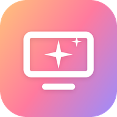

[English](README.md) · [Español](README.es.md) · **Português**

# Free My TV · versão streaming

**Uma tela inicial sem anúncios para Google TV, no estilo dos apps de streaming.**

Um destaque com trailer, fileiras de sugestões do TMDB e do que você assiste no Stremio, uma aba por serviço, uma página por série e um player próprio.

[Capturas](#capturas) · [Instalação passo a passo](SETUP.pt.md) · [Ajustes](#ajustes) · [Voltar ao original](#voltar-ao-original)

> **Baseado no [Free My TV](https://github.com/simbasjungles/free-my-tv)** de simbasjungles e colaboradores (licença MIT). Este repositório é um trabalho derivado: mantém a base do original (a troca segura da tela inicial, a lista de apps protegidos, o watchdog, o build sem Gradle) e substitui a tela inicial por completo. Esta versão não tem site; tudo o que você precisa está aqui e no [SETUP.pt.md](SETUP.pt.md).

## O que tem

- **Sem anúncios.** Nada de fileiras patrocinadas, banners ou promos que tocam sozinhas.
- **Um destaque com trailer.** O título em foco cresce para 16:9 e toca o trailer dentro do card, no seu idioma quando existe.
- **Uma aba por serviço:** Para você, Netflix, Disney+, Prime Video, Paramount+, Crunchyroll e Stremio, cada uma com suas fileiras.
- **Continuar assistindo e Novos episódios** da sua conta do Stremio, e sugestões pelo que você assiste.
- **Segure OK num card** para o menu dele: assistir, adicionar ou tirar da Minha lista, tirar de Continuar assistindo (no Stremio também). Num app: mover ou tirar da fileira.
- **Uma página por série** com retomar, temporadas, episódios e próximas estreias.
- **Um player próprio** para os títulos do Stremio, com áudio, legendas e versão para escolher, e o seu ponto sincronizado com o Stremio (o que você assiste aqui aparece igual no Stremio e no celular).
- **Abre cada título no seu app:** Netflix, Disney+ e Prime Video abrem direto no filme ou na série, o Stremio no episódio.
- **Busca, todos os seus apps e o clima** da sua cidade no canto superior direito.
- **Seguro.** Sem root. Nada é desinstalado. Um botão traz de volta a tela inicial de fábrica.

O app inteiro (tela inicial, player, busca e ajustes) está em espanhol, inglês ou português do Brasil (`language=es`, `en` ou `pt`), e a dublagem e as legendas seguem o idioma: português do Brasil ou espanhol latino primeiro. As capturas mostram em espanhol.

## Capturas

| | |
|---|---|
|  **Para você:** o destaque, com o trailer |  **Continuar assistindo,** da sua conta do Stremio |
|  **Minha lista,** o que você guarda de qualquer card |  **Novos episódios** das suas séries |
|  **Novidades:** as estreias |  **Uma aba por serviço:** Netflix |
|  **Fileiras próprias** em cada serviço |  **Anime** (Crunchyroll) |
|  **Continuar assistindo** em cada serviço |  **O menu:** busca, séries, filmes, apps e ajustes |
|  **Todos os seus apps,** com busca |  **Busca** |
|  **Uma página por série:** retomar, temporadas e próximos episódios |  **O player próprio,** com o seu ponto sincronizado com o Stremio |
|  **Áudio, legendas e versão** | |

## Instalação

Uns 20 minutos na primeira vez. Você precisa de uma TV com Google TV ou Android TV (Android 12 ou mais novo) e de um computador na mesma rede Wi-Fi.

**Todos os passos, um por um, estão no [SETUP.pt.md](SETUP.pt.md):** as ferramentas, preparar a TV, cada chave (TMDB, Stremio, YouTube) e como conseguir, compilar, instalar, ativar e o que fazer se algo der errado.

Usa o [Claude Code](https://claude.com/claude-code)? Clone o repositório, abra o Claude Code na pasta e diga *"Instale o Free My TV na minha TV em 192.168.1.50. Moro em São Paulo."* Ele instala o que falta, compila e coloca na sua TV (o [CLAUDE.md](CLAUDE.md) diz como). As chaves você mesmo cola no `config.properties`.

## Ajustes

Tudo fica no `config.properties`, criado pelo primeiro `./build.sh` e que nunca vai para o git:

| Chave | Para que serve | Padrão |
|---|---|---|
| `tmdb_key` | Sugestões, imagens, logos e trailers. **Necessária** para a tela inicial. | vazia |
| `tmdb_region` | Seu país (duas letras): qual título está em qual serviço | `US` |
| `latitude`, `longitude` | Sua cidade, para o clima e o visual noturno | Nova York |
| `city` | O nome ao lado do clima | vazio |
| `language` | `pt`, `es` ou `en`: o app, os títulos do TMDB e a dublagem e as legendas preferidas. `auto` segue a TV | `auto` |
| `temperature` | `C`, `F` ou `auto` | `auto` |
| `stremio_key` | Continuar assistindo, Minha lista, sugestões e o player. Opcional. | vazia |
| `youtube_key` | Trailers no seu idioma que o TMDB não tem. Opcional. | vazia |
| `currency` | Moeda dos preços de cripto (não aparecem nesta tela inicial) | `USD` |
| `disable_assistant` | Também desliga o Google Assistente | `false` |

O idioma também se troca na TV, sem recompilar: *Free My TV* → *Idioma*. Como conseguir cada chave: [SETUP.pt.md](SETUP.pt.md#3-as-chaves). Mudou algo? Rode `./build.sh` e instale de novo. Guarde o `freemytv.keystore`: as atualizações são assinadas com ele.

## Voltar ao original

Na TV: *Free My TV* → *Início* → *Original*. A tela inicial de fábrica, o protetor de tela e todos os apps voltam exatamente como estavam. Se a tela inicial nova falhar três vezes em cinco minutos, ela volta sozinha.

Para remover de vez, troque para *Original* primeiro e depois desinstale o *Free My TV* (Configurações → Apps).

## O que muda na TV

- Vira a tela inicial e o protetor de tela.
- Desliga, sem desinstalar:
  - a tela inicial e o protetor de tela de fábrica, com os atalhos do controle que dependem deles em algumas TVs (como o botão da Netflix na TCL);
  - a tela inicial de recuperação do Google TV, o Play Games e o YouTube Music;
  - nas TVs TCL, o TCL Channel, mensagens, demo de loja, menu de hotel, manuais, espelhamento e apps de registro;
  - o Google Assistente, só com `disable_assistant=true`.
- Imagem, som, entradas, pareamento do controle, serviços do Google e Play Store estão numa lista protegida, conferida antes de cada mudança.

## Outras TVs

Funciona em Google TV e Android TV: TCL, Hisense, Sony, Philips, Xiaomi e outras, e em streamers como Chromecast com Google TV, Google TV Streamer, onn 4K e NVIDIA Shield. **Samsung, LG ou outra TV:** ligue um streamer com Google TV no HDMI e instale nele.

Para adaptar a outra marca, as listas estão no código:

| O quê | Onde |
|---|---|
| Apps a desligar | `DEBLOAT` em [`HomeMode.java`](app/src/io/freemytv/HomeMode.java) |
| Apps que nunca são tocados | `PROTECTED` no mesmo arquivo |
| Apps da fileira | `SHELF` em [`HomeApps.java`](app/src/io/freemytv/HomeApps.java) |
| O app de TV ao vivo da sua marca | `LIVE_TV_APPS` no mesmo arquivo |

## Como funciona

- **Um app Android simples em Java, sem Gradle.** O [`build.sh`](build.sh) roda aapt2 → javac → d8 → zipalign → apksigner. A única biblioteca é o ExoPlayer (Media3), para o player; o `build.sh` baixa sozinho na primeira vez.
- **Usa o ADB da própria TV, de dentro da TV.** O app se conecta a `127.0.0.1:5555` com a própria chave (por isso a TV pergunta *Permitir depuração USB?*) e roda os mesmos comandos que você rodaria: `cmd package set-home-activity`, `settings put secure screensaver_components`, `pm disable-user`. Nada fica escutando na rede.
- **Uma rede de segurança.** Um watchdog em outro processo traz de volta a tela inicial de fábrica depois de três falhas em cinco minutos, e uma verificação ao ligar mantém a sua escolha depois das atualizações da TV.

| Arquivo | O que é |
|---|---|
| [`FlixView.java`](app/src/io/freemytv/FlixView.java) | A tela inicial no estilo streaming |
| [`Recs.java`](app/src/io/freemytv/Recs.java) | Sugestões e trailers (TMDB, Stremio, YouTube, Wikidata) |
| [`Streams.java`](app/src/io/freemytv/Streams.java) | Os streams e o seu ponto no Stremio |
| [`PlayerActivity.java`](app/src/io/freemytv/PlayerActivity.java) | O player |
| [`SearchActivity.java`](app/src/io/freemytv/SearchActivity.java) | Busca |
| [`HomeMode.java`](app/src/io/freemytv/HomeMode.java) | A troca entre Free My TV e Original |
| [`Adb.java`](app/src/io/freemytv/Adb.java) | O ADB da TV, de dentro da TV |
| [`Watchdog.java`](app/src/io/freemytv/Watchdog.java) | A rede de segurança |

## Privacidade

Sem contas próprias, sem analytics, sem rastreamento. O app só fala com o TMDB, o Open-Meteo (com as coordenadas que você definir), o Wikidata (para abrir cada título no seu app), o YouTube (os trailers, e a busca se você definir `youtube_key`) e, se você definir `stremio_key`, com a sua conta do Stremio e os add-ons dela. Suas chaves e ajustes ficam no seu computador e na sua TV.

## Créditos

- **[Free My TV](https://github.com/simbasjungles/free-my-tv)** de simbasjungles e colaboradores: o projeto original em que esta versão se baseia (MIT).
- Feito com [Claude Code](https://claude.com/claude-code).
- Este produto usa a API do TMDB, mas não é endossado nem certificado pelo [TMDB](https://www.themoviedb.org/).
- Clima do [Open-Meteo.com](https://open-meteo.com/) (CC BY 4.0). Identificadores de títulos do [Wikidata](https://www.wikidata.org/) (CC0).
- Player: [AndroidX Media3 / ExoPlayer](https://github.com/androidx/media) (Apache 2.0).
- Ícones: [Material Symbols](https://fonts.google.com/icons) (Apache 2.0). Fonte: [Inter](https://rsms.me/inter/) (SIL OFL 1.1).
- Sem relação com Google, TCL, Hisense, Stremio ou qualquer serviço de streaming. Os nomes e logos dos apps pertencem aos donos.

## Licença

[MIT](LICENSE), como o original: o aviso de copyright e a licença do projeto original são mantidos.
